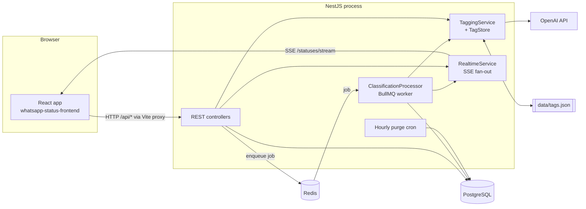
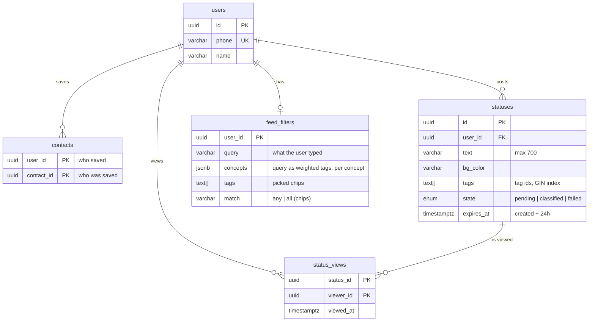
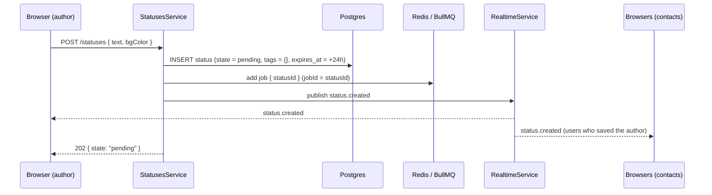
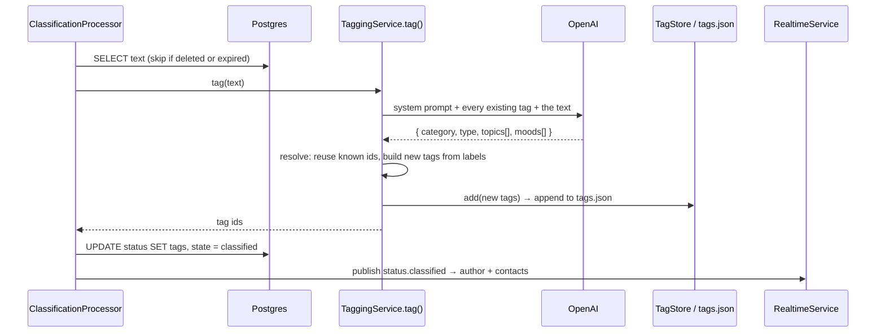
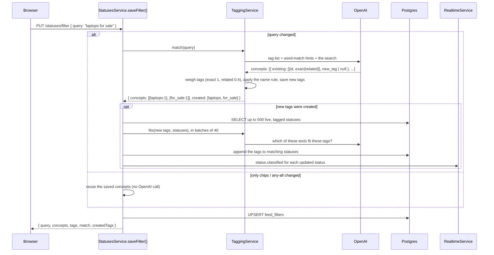
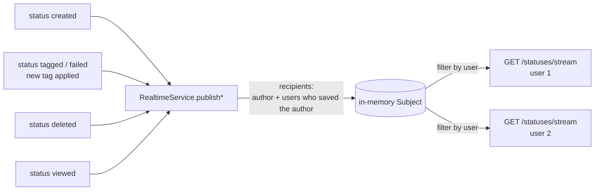

# Architecture

How the status app works: its components, its data, and each flow from request
to screen. For setup, see [README.md](README.md).

## The big picture

Users post short text statuses that disappear after 24 hours, and see the
statuses of the people they saved as contacts. Two things make it more than a
list:

1. **Every status is tagged by OpenAI** with a category, a type (the author's
   intent), topics and a mood. Tags come from one shared list that **grows on
   its own**: when nothing fits, a new tag is created.
2. **Every user has a saved feed filter.** They type what they want to see
   ("laptops for sale"), it is mapped onto **weighted** tags once, saved in the
   database, and applied to every feed load until they change it. *Exact* tags
   decide what is shown; *related* tags only rank it, and every result gets a
   relevance score. If the search mentions something no tag covers yet, a tag
   is learned and applied to existing statuses.

Changes (new, tagged, deleted, viewed) are pushed to the browser over
Server-Sent Events, so nobody has to refresh.



Everything runs in **one Node process**: the HTTP API, the queue worker, the
tag store and the SSE fan-out. That keeps setup simple, and it is the main
scaling limit (see [Limits](#limits-and-scaling)).

## Components

### Backend modules (`src/`)

| Module | Files | Responsibility |
|---|---|---|
| **Users** | `users/` | Register and log in by phone. Global module; also provides `AuthGuard`. |
| **Auth (placeholder)** | `common/auth.guard.ts` | Trusts `x-user-id` (or `?userId=` for SSE) and loads the user. To be replaced with JWT/OTP. |
| **Contacts** | `contacts/` | One-way links: *I saved X*, so I see X's statuses. |
| **Statuses** | `statuses/` | Create, list, view tracking, delete, the feed, saved filters, the expiry cron. |
| **Classification** | `classification/` | The BullMQ queue `status-classification` and its worker, which tags new statuses. |
| **Tagging** (shared) | `tagging/` | `TagStore` (the tag list) and `TaggingService` (all OpenAI calls). Has no knowledge of statuses, so any feature can reuse it. Serves `GET /tags`. |
| **Realtime** | `realtime/` | In-memory pub/sub that turns domain events into per-user SSE streams. |

### Frontend (`../whatsapp-status-frontend/src/`)

| File | Responsibility |
|---|---|
| `api.ts` | Every REST call; adds `x-user-id`. |
| `realtime.ts` | One `EventSource` per tab; components subscribe with `useStatusEvent()`. |
| `App.tsx` | Session, loads tags and the saved filter, saves filter changes. |
| `FeedFilterBar.tsx` | Search box (submitted on Enter) and tag chips grouped by tag group. |
| `Feed.tsx` | Fetches the feed, then applies live events with the same filter rules as the server. |
| `MyStatuses.tsx` | Your statuses, their tags and live view counts. |
| `StatusViewer.tsx` | Full-screen viewer; tracks the open status by id so live inserts and deletes don't make it jump. |
| `TagBadges.tsx` | Renders tags (category as a coloured badge, the rest as `#chips`). |

### External services

| Service | Used for |
|---|---|
| **PostgreSQL** | All durable data. Tag arrays are indexed with GIN for fast filtering. |
| **Redis** | BullMQ job queue only. |
| **OpenAI** (Chat Completions, structured outputs) | Tagging statuses, mapping searches to tags, checking which statuses a new tag fits. |
| **`data/tags.json`** | The shared tag list. A file, so it's easy to read and edit by hand. |

## Data model



All foreign keys cascade on delete. The schema is in `db/init.sql`, and
upgrades are in `db/migrations/`. TypeORM's `synchronize` is off, so schema
changes are always explicit SQL.

### Tags (`data/tags.json`)

```json
{ "id": "for_sale", "group": "type", "label": "For sale",
  "description": "Statuses where someone is selling, offering, or promoting something for purchase." }
```

| Group | Per status | Meaning | Examples |
|---|---|---|---|
| `category` | exactly 1 | broad subject area | `sports`, `tech`, `beauty_fashion` |
| `type` | exactly 1 | the author's intent | `announcement`, `for_sale`, `wish`, `question` |
| `topic` | 0-3 | specific things, products, places, events | `cricket`, `nodejs`, `macbook_pro` |
| `mood` | 0-1 | feeling, when clear | `happy`, `excited`, `upset` |

- **IDs** are lowercase snake_case, always derived from the label on our side
  (`"Food & Travel"` → `food_travel`), never invented by the model.
- **Statuses store tag IDs** (`statuses.tags`). The label and description live
  only in the file, so renaming a label in `tags.json` updates every status's
  display.
- **The file is written atomically**: to a temp file, then renamed, sorted by
  group then ID. Writes are queued in a promise chain so concurrent jobs can't
  interleave.

## Flows

### 1. Posting a status



The request returns at once. Tagging happens in the background (flow 2). The
`jobId` equals the status ID, so a status can't be queued twice.

### 2. Tagging a status (background)

`ClassificationProcessor` (concurrency 4) picks up the job:



- **The answer has one slot per group** (`category` and `type` are single
  required objects), enforced by OpenAI structured outputs and validated again
  with Zod. The model can't skip the category.
- **Reuse before create.** The model sees the whole tag list and is told to
  return existing IDs. On our side, a suggestion is matched to an existing tag
  by ID *or* by its label's normalized ID, so "Node JS" reuses `nodejs`.
- **Failures:**
  - Missing key, `400/401/403/404` or `insufficient_quota`: retrying can't help,
    so the status goes straight to `failed` (`UnrecoverableError`).
  - Anything else (rate limits, timeouts, malformed output): retried 3 times
    with exponential backoff (2s, 4s), then `failed`.
  - Either way, a `status.classified` event with `state: "failed"` is sent, so
    the UI stops showing "tagging…".

### 3. Saving a feed filter (search, with tag learning)

The user types what they want and presses **Enter** (or clicks a chip). The
frontend sends `PUT /statuses/filter { query, tags, match }`.



How `TaggingService.match()` reads a search:

- **It splits the search into concepts** and ignores filler like "I want to
  see… only". "laptops for sale" becomes *laptops* + *for sale*.
- **Each concept maps to existing tags with a weight**, and/or proposes **one
  new tag** when nothing means what was asked:
  - **exact** (weight `1`): means what the user asked for. A status needs one
    exact tag per concept to be shown.
  - **related** (weight `0.4`): broader or neighbouring tags. They only raise
    a status's score.
  - Example: "birthday" → `birthday` exact, `celebration` related. A wedding
    wish (`celebration`, `wish`, `wedding`) is *not* shown; a birthday wish is.
- **The name rule** (deterministic, applied after the model): if a tag's own
  name (label or id) contains a word of the search, that tag is exact and the
  concept's other tags become related. Descriptions don't count, so
  *Wishes & Celebrations* (whose description mentions birthdays) can't make
  every wish match "birthday". The model is not fully consistent about
  exact vs related; this rule makes the obvious cases stable.
- **A concept always has at least one exact tag**: if the model marked none
  (and the name rule found none), all its tags are treated as exact. A newly
  learned tag is always exact.
- **Word-match hints** (tags whose name or description shares a whole word
  with the search, plurals included, stop words skipped) are given to the
  model. If the model still returns nothing, they are used as the answer, with
  the name rule deciding which are exact.
- **Saved filters from before weighting** (plain tag ids) are re-resolved
  automatically the next time they are read.
- **Gibberish matches nothing.** The filter is saved with no concepts, so the
  feed is empty: it never falls back to "All".
- **Results are cached in memory**, keyed by the tag count and the normalized
  search. Learning any new tag changes the count, which invalidates the cache.

`TaggingService.fits()` is what makes learning useful right away. Without it, a
newly learned `for_sale` tag would match no existing statuses, only future ones.

### 4. Loading the feed

`GET /statuses/feed` takes no filter parameters. It always reads the caller's
saved filter, so the same view comes back on reload, on another device and
after logging in again. It never calls OpenAI.

```sql
SELECT ...,
  -- relevance: weight of the search tags the status has / weight of all search tags
  round((SELECT coalesce(sum(w.weight), 0) / 1.4          -- e.g. birthday 1 + celebration 0.4
           FROM jsonb_to_recordset($weights) AS w(id text, weight float8)
          WHERE w.id = ANY(s.tags)), 2) AS relevance
-- the statuses of people I saved, still live
WHERE s.user_id IN (SELECT contact_id FROM contacts WHERE user_id = $me)
  AND s.expires_at > now()
-- one clause per search concept: the status needs an EXACT tag of each concept
  AND s.tags && '{birthday}'
-- picked chips: any of them (&&) or all of them (@>)
  AND s.tags && '{happy}'
ORDER BY relevance DESC, s.created_at DESC     -- just created_at when there is no search
LIMIT 50
```

Relevance is returned on each status (`relevance`, 0-1) and shown as
"N% match" on the tile. A birthday wish tagged `birthday` + `celebration`
scores 1.0; one tagged only `birthday` scores 0.71.

| Saved filter | Result |
|---|---|
| Nothing (the "All" chip) | Every live status from your contacts, including ones still `pending` |
| Search matched tags | Statuses with an exact tag from *every* concept (and the chips, if any), best score first |
| Search matched nothing | Empty |
| Only chips | Statuses with any (or all) of the chips |

### 5. Real-time updates



| Event | Sent to | Payload |
|---|---|---|
| `status.created` | author + people who saved the author | the status (feed shape), `pending` |
| `status.classified` | same | the status with tags, or `state: "failed"` |
| `status.deleted` | same | `{ id }` |
| `status.viewed` | the author only, on a first view | `{ statusId, viewerId, viewerName }` |
| `ping` | everyone, every 25s | keeps proxies from closing idle connections |

How the browser uses the stream:

- **One `EventSource` per tab**, opened at login (`realtime.ts`).
- **The feed applies each event with the same rules as the server**: added,
  updated or removed depending on the saved filter, with the same relevance
  score and ordering. "My statuses" re-fetches its own list and updates view counts.
- **The tag list re-fetches** when an event carries a tag ID the page hasn't
  seen.
- **After a reconnect, both lists re-fetch once**, because events sent while
  disconnected are lost.
- **On shutdown**, the server completes every stream (`onModuleDestroy`).
  Otherwise the HTTP server would wait forever on open connections, and the
  process (and watch-mode restarts) would hang.

### 6. Viewing, deleting, expiring

- **Viewing** (`POST /statuses/:id/view`) is allowed only for live statuses of
  people you saved. The first view inserts a row and sends `status.viewed` to
  the author; repeat views do nothing.
- **Deleting** removes the row (its views cascade) and sends `status.deleted`.
- **Expiry:** the feed hides statuses past `expires_at`, and an hourly cron
  deletes them. The cron sends no events, so open pages hide statuses past
  `expiresAt` themselves, or on their next fetch.

## Design decisions

| Decision | Why |
|---|---|
| Tag in a background job, not in the request | Posting stays instant; OpenAI latency and outages don't fail the post; BullMQ gives retries and backoff. |
| BullMQ on Redis rather than Kafka | One job type with one consumer, needing retries, backoff and dedupe per job: a job queue, not an event log. Kafka would add brokers and partitions for no gain at this scale. |
| One shared, growing tag list | Statuses and searches speak the same vocabulary, so filtering is an indexed array check instead of fuzzy text search. |
| The model never picks IDs for new tags | IDs come from labels, so they stay clean (`makeup`, not `new_makeup`) and duplicates collapse. |
| Structured outputs + Zod | The answer always parses; required slots (category, type) can't be skipped. |
| Search resolved once, at save time | Feed loads are fast, free and deterministic; OpenAI runs only when the user changes their search. |
| Exact vs related weights, plus the name rule | Broad tags (a category) would otherwise pull in everything near a search ("birthday" → every wish). Weights keep results precise while still ranking closer matches higher; the name rule makes this stable where the model wavers. |
| Filter saved in the database | It follows the user across reloads and devices, and the server always applies it. |
| SSE instead of WebSockets | One-way server → browser updates; plain HTTP, built into NestJS and browsers, automatic reconnect. |
| Tags in a JSON file | Easy to read, review and edit by hand at this size. |

## Limits and scaling

| Limit | Why | Path forward |
|---|---|---|
| **Single instance only** | Tags live in one process's memory and file; SSE fan-out is in memory | Move tags to a Postgres table; publish events through Redis pub/sub; run the worker separately |
| Every status and every new search costs an OpenAI call | Tagging and matching are model-based | Fine at small scale; batch tagging, or a cheaper model via `OPENAI_MODEL` |
| The tag list only grows | Any genuinely new concept creates a tag | Periodic review: merge or delete tags in `tags.json` |
| Saved searches don't pick up tags learned later | Concepts are resolved at save time | Re-resolve saved searches when tags are learned |
| Tags learned while *posting* aren't applied to older statuses | Only search-learned tags are backfilled | Run `fits()` for those tags too |
| Status tags aren't weighted | A status either has a tag or not; only search tags carry weights | Have the tagger return a confidence per tag and multiply it into the score |
| Statuses tagged before a prompt change keep their old tags | Tags are set once per status | `node scripts/retag-statuses.mjs --all` |
| A learned tag is checked against at most 500 live statuses | Bounds cost and latency of a search | Raise `BACKFILL_LIMIT` or backfill in a job |
| Saving the status and queueing its job aren't atomic | If Redis is down at that moment, the status stays `pending` | Transactional outbox, or a sweeper that re-queues old `pending` rows |
| Auth is a placeholder | Anyone can send any `x-user-id` | JWT/OTP; pass the token to SSE via cookie or query |

## Where to change things

| To change… | Edit |
|---|---|
| How statuses are tagged (groups, limits, prompt) | `src/tagging/tagging.service.ts` (`SYSTEM_PROMPT`, `resolve()`) |
| How searches map to tags | `src/tagging/tagging.service.ts` (`MATCH_PROMPT`, `match()`, `nameMatch()`, `STOP_WORDS`) |
| Exact / related weights | `EXACT_WEIGHT`, `RELATED_WEIGHT` in `src/tagging/tagging.service.ts` |
| Ranking | `feed()` in `src/statuses/statuses.service.ts`; mirror it in the frontend's `Feed.tsx` (`relevanceOf`) |
| The tags themselves | `data/tags.json`, then restart |
| Feed rules | `src/statuses/statuses.service.ts` (`feed()`); mirror any change in the frontend's `Feed.tsx` (`matchesFilter`) |
| Retries and worker concurrency | `src/classification/classification.module.ts`, `classification.processor.ts` |
| Which events are sent and to whom | `src/realtime/realtime.service.ts` and its callers |
| Reusing tagging elsewhere (e.g. products) | Import `TaggingModule`; call `tag(text)`, `match(query)`, `fits(tags, items)` |
